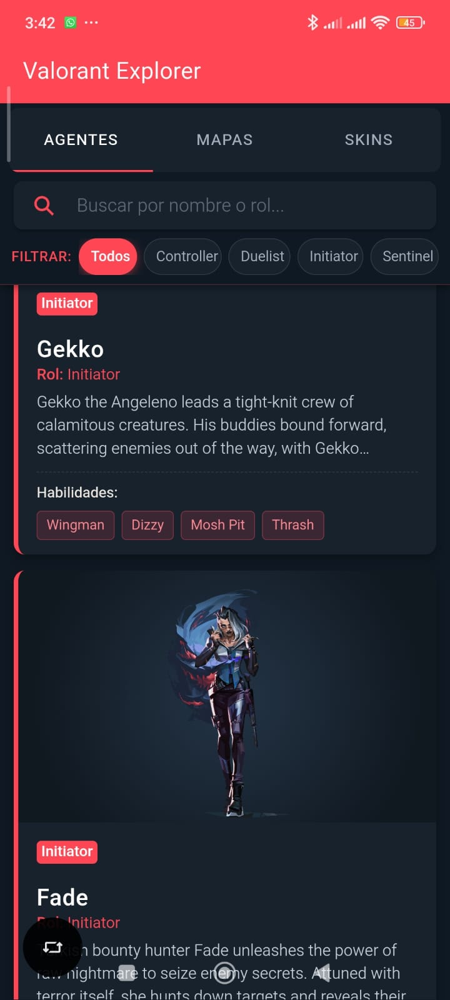
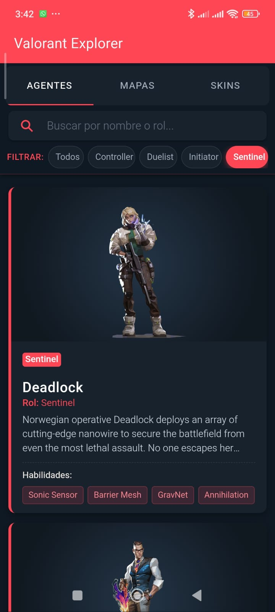
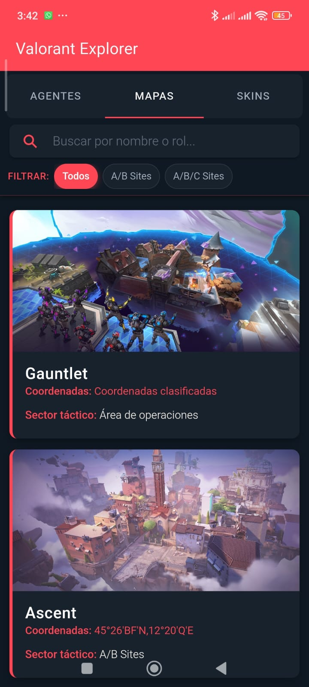
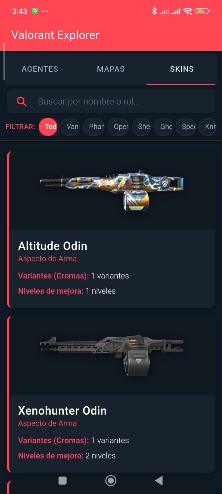

# 🎯 Valorant API Explorer

Aplicación móvil desarrollada con **Ionic Framework**, **Angular Standalone** y **Capacitor** para explorar el catálogo oficial de agentes, mapas y skins del videojuego Valorant.

Proyecto realizado para el taller práctico de integración de APIs públicas (**ESFOT • Desarrollo de Aplicaciones Móviles**).

---

## 📌 Requisitos Implementados

| Requisito | Funcionalidad | Descripción |
| :--- | :--- | :--- |
| **R1** | **Listado remoto** | Tarjetas (`<ion-card>`) con imágenes reales y múltiples atributos por entidad (rol, descripción, habilidades, coordenadas, variantes). |
| **R2** | **Infinite scrolling** | Carga incremental mediante `<ion-infinite-scroll>` en lotes de 6 elementos sin duplicados, con control de estados (`loading`, `hasMore`) y desactivación al agotarse el catálogo. |
| **R3** | **Búsqueda y filtros** | `<ion-searchbar>` con `debounce` para búsqueda por nombre/rol, complementado con chips interactivos (`<ion-chip>`) para filtrar rápidamente por categorías. |
| **R7** | **Estructura de código** | Separación modular en Servicio HTTP (`ValorantService`), Interfaces TypeScript fuertemente tipadas y componentes Standalone. |

---

## 🌐 Endpoints de la API Utilizados

API Base: `https://valorant-api.com/v1`

* **Agentes:** `GET /agents?isPlayableCharacter=true`
* **Mapas:** `GET /maps`
* **Skins de Armas:** `GET /weapons/skins`
* **Detalle (preparados en servicio):** `GET /agents/{agentUuid}`, `GET /maps/{mapUuid}`

---

## 📸 Capturas de Pantalla

| Listado de Agentes (R1 & R2) | Búsqueda y Filtros por Rol (R3) |
| :---: | :---: |
|  |  |

| Catálogo de Mapas | Catálogo de Skins |
| :---: | :---: |
|  |  |

> *(Coloca tus capturas en la carpeta `screenshots/` con los nombres indicados).*

---

## ⚙️ Decisiones Técnicas y de Paginación

1. **Paginación en Cliente para Infinite Scroll:**
   * La API de Valorant retorna la colección completa en una sola llamada JSON.
   * Para cumplir estrictamente con el ciclo de vida del `ion-infinite-scroll` sin sobrecargar el DOM ni congelar la interfaz, se programó una entrega incremental en lotes de 6 elementos (`pageSize = 6`).
2. **Detección de Cambios en Angular Zoneless:**
   * Al utilizar Angular en modo *Zoneless*, se integró `ChangeDetectorRef.markForCheck()` y `provideHttpClient(withFetch())` para garantizar que la interfaz se actualice inmediatamente al recibir las respuestas asíncronas de la API.
3. **Filtro de Calidad en Skins:**
   * Se descartaron las skins genéricas o sin imagen (`displayIcon === null`), asegurando que todos los elementos mostrados en pantalla cuenten con gráficos reales y de calidad.

---

## 📁 Estructura del Proyecto

```text
src/
├── app/
│   ├── models/
│   │   └── valorant.models.ts       # Interfaces TypeScript (R7)
│   ├── services/
│   │   └── valorant.ts              # Servicio HTTP HttpClient (R7)
│   ├── pages/
│   │   └── valorant-list/           # Componente principal (R1, R2, R3)
│   │       ├── valorant-list.page.html
│   │       ├── valorant-list.page.scss
│   │       └── valorant-list.page.ts
│   └── app.routes.ts                # Enrutador principal
├── theme/
│   └── variables.scss               # Colores temáticos de Valorant (#ff4655, #0f1923)
└── main.ts                          # Configuración de Providers Standalone
```

---

## 🚀 Instalación y Ejecución

1. **Clonar el repositorio:**
   ```bash
   git clone https://github.com/alexbarba2753/ValorantAPI.git
   cd ValorantAPI
   ```

2. **Instalar dependencias:**
   ```bash
   npm install
   ```

3. **Iniciar el servidor de desarrollo:**
   ```bash
   ionic serve
   # o bien:
   npm start
   ```

4. **Compilar para producción:**
   ```bash
   npm run build
   ```
